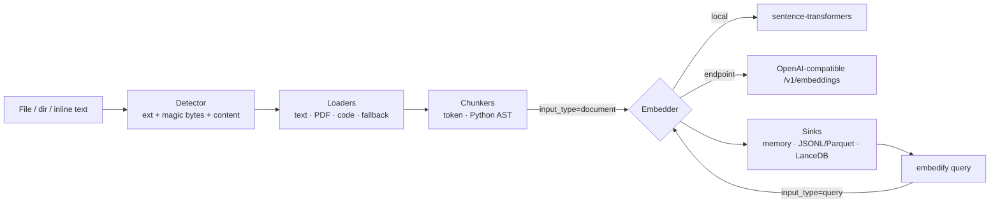

# embedify

Embed **any** data — text, PDFs, code, tables, time series, and archives —
into vectors with full provenance, ready for RAG. (Media modalities —
images, audio, video — are future work; see the support matrix.)

One entry point:

```python
import embedify
result = embedify.embed("docs/")                                       # index (input_type="document")
hits = embedify.query("how do refunds work?", db="./embedify.lancedb") # search (input_type="query")
```

```bash
embedify embed ./docs --sink lancedb --output ./embedify.lancedb
embedify query "how do refunds work?" --db ./embedify.lancedb
```

Every vector is an `EmbeddingRecord {id, vector, model, model_version, dim, modality,
source_uri, locator (page/lines/chars), content_hash, text_preview, metadata, created_at}` —
traceable to the exact source span, for RAG citations.

> ⚠️ Vectors are only comparable within the same `model + model_version + dim`.
> embedify stamps all three on every record; never mix models in one index/query.

## Quickstart

```bash
pip install embedify                 # core (endpoint backend, no model download)
pip install 'embedify[local,lancedb,pdf]'   # + local models, LanceDB, PDF

embedify embed ./docs            # persists to ./embedify.lancedb by default
embedify query "your question"   # cosine-similarity score, higher = better
```

**Two ways to run models — your choice per modality:**

| Mode | Config | Needs |
|---|---|---|
| **Local** (default) | `backend: local, model: BAAI/bge-small-en-v1.5` | `embedify[local]`, ~130 MB download, runs on CPU |
| **Endpoint** | `backend: endpoint, base_url: http://localhost:11434/v1, model: nomic-embed-text` | any OpenAI-compatible `/v1/embeddings` server: OpenAI, Ollama, vLLM, TEI, LM Studio |

Default model: **`BAAI/bge-small-en-v1.5`** (384-dim, strong retrieval, CPU-friendly).
Fastest option: `sentence-transformers/all-MiniLM-L6-v2`. Non-English:
`intfloat/multilingual-e5-small` (see `embedify models`).

`input_type` matters: BGE/E5 models embed queries and documents differently.
embedify handles this automatically — indexing passes `document`, `embedify query`
passes `query`, and each adapter maps it to the model's instruction prefix
(or, later, Cohere/Voyage's native `input_type` parameter).

embedify is a **producer**: it writes embeddings + provenance metadata to a
sink and stops there. Retrieval/search/MCP are your consuming system's job —
`embedify query` exists only as a smoke test that the sink is readable.
The output contract is versioned and documented in
[docs/schema.md](docs/schema.md) (JSON Schema: `docs/schema.json`), including
how to read LanceDB/Parquet/pgvector stores **without importing embedify**.

## Config (`embedify.yaml`)

```yaml
embedders:
  text: {backend: local, model: BAAI/bge-small-en-v1.5}
  # or: {backend: endpoint, base_url: http://localhost:11434/v1, model: nomic-embed-text, api_key_env: null}
chunkers:
  text: {max_tokens: 512, overlap: 64}
  code: {strategy: treesitter}   # default; ast = Python-only fallback
sink: {type: lancedb, path: ./embedify.lancedb, table: chunks}
shared_space: false   # future: one multimodal model, cross-modal comparable vectors
```

Env overrides: `EMBEDIFY_SINK__TYPE=file`, `EMBEDIFY_EMBEDDERS__TEXT__MODEL=...`.

Archive limits are configurable under `archive:` (`max_files`,
`max_member_bytes`, `max_total_bytes`, `max_nesting_depth`).

### Semantics worth knowing

- **Secret exclusion is file-granular.** `.env`-style/key/credential files
  are skipped wholesale, and *any* file containing one detected secret
  (key patterns, private keys, assignments) is excluded entirely — clean
  functions in the same file are excluded too. Findings are reported as
  kind + line only, never the value (CLI: `secret_findings`).
- **Commit SHA is embedding-run provenance.** With `--incremental`,
  unchanged files are skipped, so their stored records keep the commit
  SHA (and all metadata) from the run that embedded them — it is *not*
  refreshed to current HEAD. A renamed file is treated as delete-plus-new:
  the old path's records are removed and the new path is embedded fresh.
- **Stats:** every `embedify embed` output includes a `stats` block —
  files scanned / processed / failed / skipped (with `skipped_by_reason`),
  units processed/embedded, elapsed seconds, and units/sec.
- **Archives** (`.tar/.tar.gz/.tgz/.zip`) are extracted safely and then
  processed exactly like directories, recursively up to the nesting
  limit; records keep `archive.tar.gz!inner/path.py` source URIs.

## Architecture



## Supported formats (Phases 1–2)

| Format | Modality | Status |
|---|---|---|
| .txt .md .rst .log .html .eml | text | ✅ (.md: heading-aware chunker, heading path prepended) |
| .pdf (text layer; scanned→OCR flag) | document | ✅ `embedify[pdf]` |
| .py .ts/.js .go .rs .java .c/.cpp + 20 code extensions | code | ✅ tree-sitter symbol chunks (`embedify[code]`): function/method/class/module-header, `path > parent > signature` context header, git provenance (repo/branch/commit/path) in metadata |
| Repos / directories | code+text | ✅ `.gitignore` respected; vendored/generated/minified/lock/binary skipped; `--incremental` replaces changed files and removes deleted ones; secret files & leaked keys excluded and reported (kind+line only) |
| .tar .tar.gz .tgz .zip archives | any contained | ✅ extracted safely (no traversal/links, size limits), processed like a directory; archives in directory walks and inside other archives expand recursively (depth ≤ 5); records keep `archive.tar.gz!inner/path.py` source URIs |
| Unknown/binary | unknown | ✅ metadata-only + warning, never crashes |
| CSV/TSV/JSON/JSONL/Parquet/Excel/SQLite | tabular | ✅ row/column/table granularity, serialize-to-text; `stats` backend = native feature path |
| CSV/Parquet with timestamps, Prometheus `.prom` | timeseries | ✅ sliding windows, normalization, irregular-sampling flag, stats-feature baseline |
| DataFrame / `list[dict]` Python objects | tabular | ✅ via `embedify.embed(df_or_rows)` |
| Images, audio, video, shared-space | image/audio/video | 🔜 deferred |
| pgvector sink, hash cache/resume, FastAPI | — | 🔜 later phase |

## Write your own loader / embedder

Loaders and embedders are small protocols — implement `supports/load` or
`embed_batch(texts, input_type=...)`, register in `embedify.loaders.LOADERS`
or construct via config. See `docs/decisions/` for the design contracts.

## Development

```bash
pip install -e '.[dev,local,lancedb,pdf]'
pytest && ruff check src tests && mypy src
```

Apache-2.0 · See [CONTRIBUTING.md](CONTRIBUTING.md)
